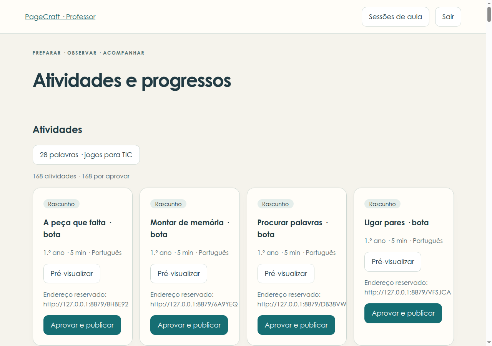
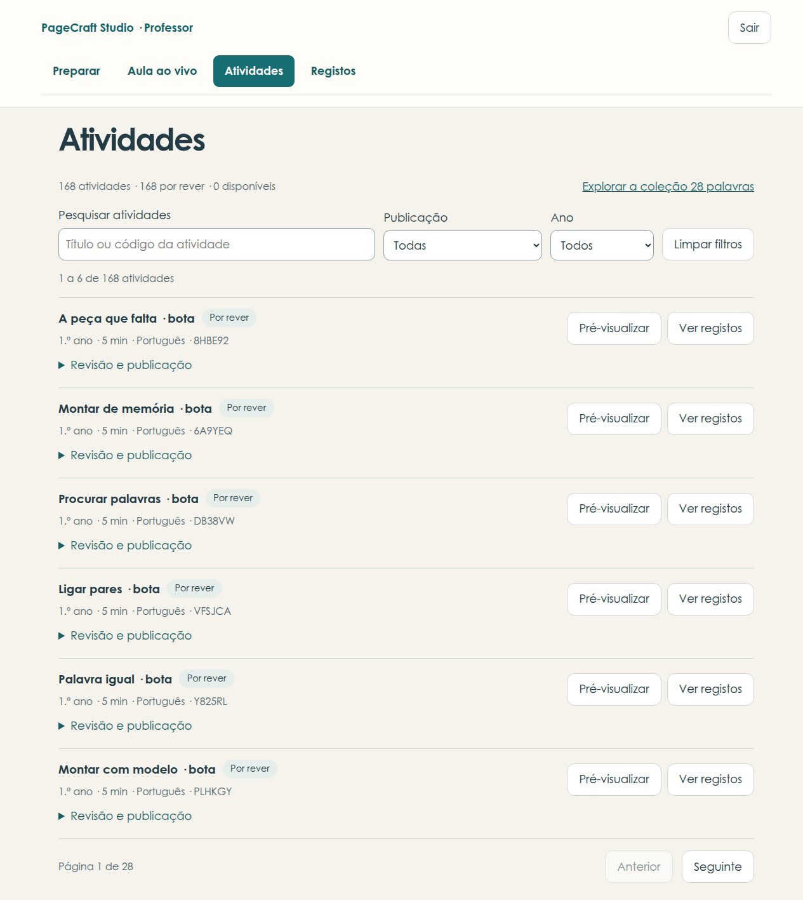
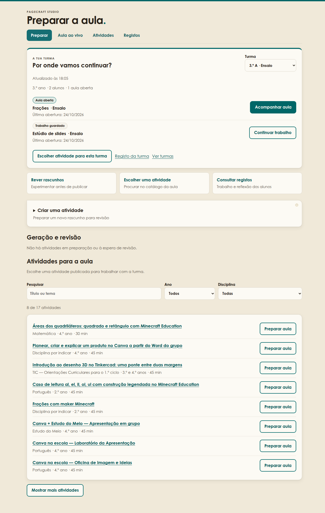

# Painel do professor — escolhas e verificação

Em 24/10/2026, quatro agentes propuseram alternativas ao painel existente. A comparação partiu de `de21a81`, usando o browser Agent Browser Hub, um Studio descartável e a coleção de 168 rascunhos. Os nomes de alunos, turmas e sessões usados no ensaio são fictícios.

## Escolha das alternativas

Os critérios foram acesso às tarefas frequentes, conservação do contexto, estados compreensíveis, teclado, ecrãs estreitos e compatibilidade com as APIs existentes.

| Alternativa | Decisão implementada | Compromisso |
| --- | --- | --- |
| A — A aula em primeiro lugar | Ações distintas para acompanhar aula aberta, continuar trabalho guardado e escolher atividade. | A criação fica num formulário recolhido; os atalhos mantêm a preparação acessível. |
| B — Turmas e contexto | Seleção explícita da turma, transportada nos atalhos para aula e relatório; retoma da sessão exata. | Um seletor ocupa menos espaço do que a grelha proposta, sobretudo com poucas turmas. |
| C — Prioridades e acompanhamento | Revisões pendentes antes do histórico; estados separados para carregamento, erro e ausência de dados. | O acompanhamento dos grupos continua na aula ao vivo, evitando duplicar a sua lógica na entrada. |
| D — Biblioteca, registos e acessibilidade | Pesquisa, filtros, páginas de seis atividades, acesso direto aos registos, contexto preservado no regresso e feedback junto da ação. | Detalhes e publicação exigem abrir uma secção; a API continua a carregar a coleção completa. |

A navegação comum oferece Preparar, Aula ao vivo, Atividades e Registos. Os registos das atividades e os registos das sessões conservam os seus percursos próprios.

## Evidência visual

| Medida | Antes | Depois |
| --- | ---: | ---: |
| Atividades desenhadas na biblioteca | 168 | 6 por página |
| Posição vertical do primeiro filtro de registos, a 1280 px | 19 644 px | 419 px, na página Registos |
| Largura do documento num ecrã de 360 px | 373 px | 360 px |

As quatro áreas foram inspecionadas a 360 e 1280 px, sem erros JavaScript ou transbordo horizontal. Os testes de filtros incluem também 768 px.

Antes, biblioteca a 1280 px:



Depois, biblioteca a 1280 px:



Depois, preparação com contexto da turma:



[Captura da biblioteca a 360 px](painel-professor/biblioteca-mobile.png).

## Verificação executada

```sh
uv run pytest -q --ignore=tests/browser
PAGECRAFT_TEST_CDP=http://127.0.0.1:9330 uv run --with playwright pytest \
  tests/browser/test_teacher_dashboard.py tests/browser/test_generation_review.py \
  tests/browser/test_catalog_years.py tests/browser/test_board_session_switch.py \
  tests/browser/test_group_continuation_ui.py tests/browser/test_help_context_drawer.py -q
```

Resultados: **580 testes sem browser e 27 testes de browser aprovados**. A sessão Chromium foi aberta pelo Hub, perfil `research`; os testes ligaram-se a essa sessão e usaram servidores descartáveis. A geração foi exercitada com um fornecedor fictício, sem chamadas reais a IA. Passaram também a verificação de sintaxe dos clientes alterados e `git diff --check`.

A revisão independente identificou três regressões. Todas foram reproduzidas em testes que falhavam antes da correção e passaram depois:

- O catálogo conserva a turma durante a atualização das aulas, incluindo falhas de rede.
- O acompanhamento da publicação usa o estado atual do servidor, mesmo quando o stream repete um evento antigo de revisão.
- Atualizações de outros trabalhos e mudanças na ordem dos cartões conservam o foco de teclado na revisão aberta.

A regressão inclui publicação e recusa de artefactos alterados, seleção de sessão antiga, mudança da sessão no quadro, retoma dos grupos e detalhe dos pedidos de ajuda. As APIs, as regras de publicação e a persistência não foram alteradas.
